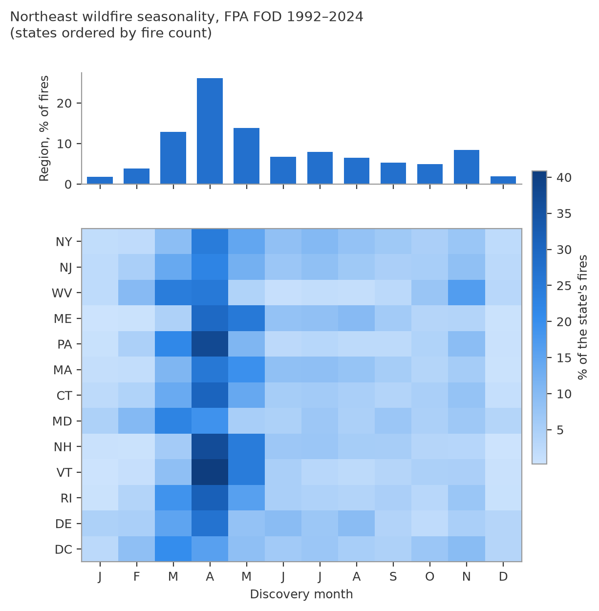
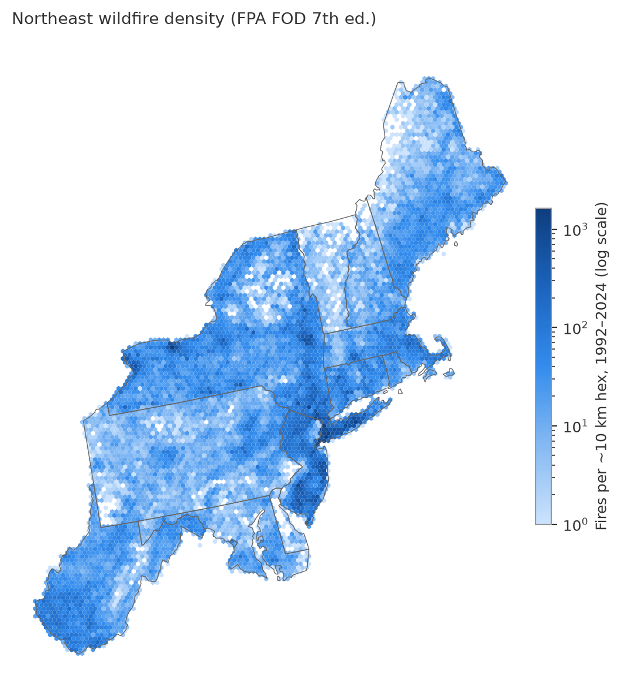
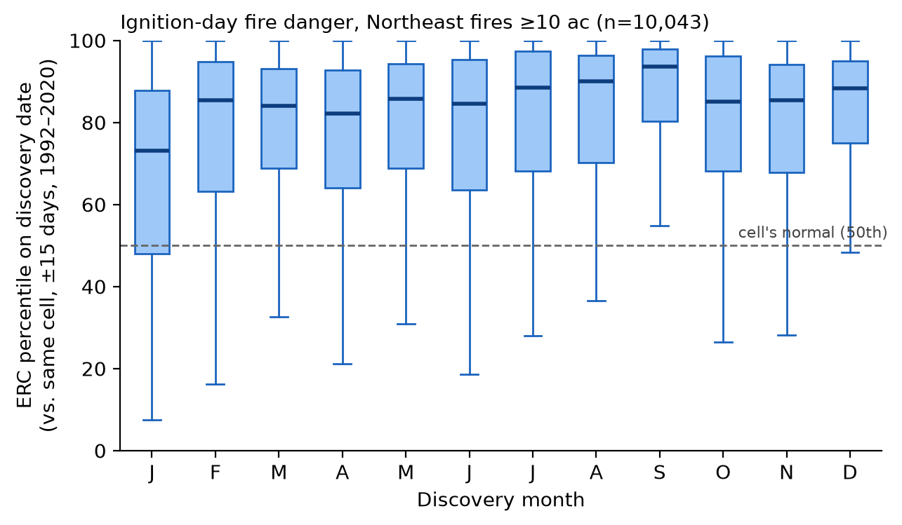
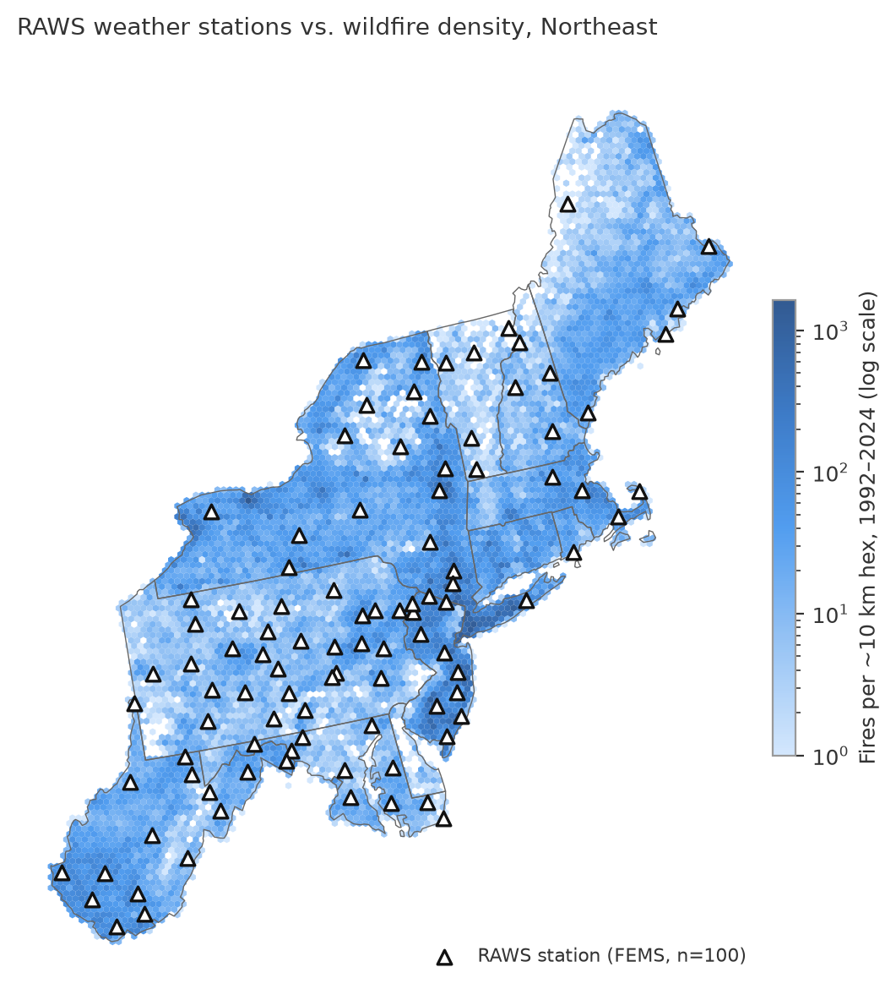

# Northeast Fire & Weather Data Assessment

When and where Northeast wildfires happen, how dry it was on the day they started, what limits prescribed-burn windows, and where the region's fire and weather data fall short. Covers the 12 USDA Northeast Climate Hub states plus DC.

## Key results

<!-- results:start -->
| Q | Result | Value | Source |
|---|---|---|---|
| Q1 | Fires in record (cleaned), 1992–2024 | 235,312 | `figures/a_qa_counts.csv` |
| Q1 | Share of fires discovered Mar–May | 52.8% | `figures/a_monthly_count_by_state.csv` |
| Q1 | Share of fires < 500 ac (below MTBS's eastern threshold) | 99.8% | `figures/a_mtbs_gap.csv` |
| Q1 | Share of burned area in fires < 500 ac | 55.2% | `figures/a_mtbs_gap.csv` |
| Q1 | Share of fires with a natural (lightning) cause | 4.2% | `figures/a_cause.csv` |
| Q2 | Fires ≥ 10 ac scored against their own cell's climatology | 10,043 | `figures/b_summary.csv` |
| Q2 | Median ERC percentile on discovery day | 84.4 | `figures/b_summary.csv` |
| Q2 | Share of fires on days above the cell's median ERC | 87.4% | `figures/b_summary.csv` |
| Q2 | Median FM100 percentile on discovery day (low = dry) | 16.6 | `figures/b_summary.csv` |
| Q2 | Range of state median ERC percentiles | 77.5–91.8 | `figures/b_median_percentile_by_state.csv` |
| Q3 | Hours inside the burn window, 6 RAWS, 2025 | 8.7% | `figures/c_binding_constraint_region.csv` |
| Q3 | Hours failing on wind (almost all too calm) | 64.2% | `figures/c_binding_constraint_region.csv` |
| Q3 | Hours failing on RH (almost all too humid) | 61.5% | `figures/c_binding_constraint_region.csv` |
| Q3 | Temperature failures that were too hot | 708 of 15,507 h | `figures/c_constraint_failures.csv` |
| Q4 | Active RAWS stations (FEMS), 12 states | 100 | `figures/d_station_density_by_state.csv` |
| Q4 | States with no RAWS station | CT, DE | `figures/d_station_density_by_state.csv` |
| Q4 | RAWS per 10,000 km² of land, lowest to highest (states with ≥1) | 0.63–5.25 | `figures/d_station_density_by_state.csv` |
<!-- results:end -->

Every value above is generated by `python -m src.results_table` from the CSV named in the last column.

## Figures

| | |
|---|---|
|  |  |
|  |  |

## Report

`report/northeast_fire_weather.qmd` (Quarto). One section per question, plus limitations.

## Data

| Dataset | Used for | Access |
|---|---|---|
| FPA FOD 7th ed. (Short 2026, doi:10.2737/RDS-2013-0009.7) | Fire occurrence, 1992–2024 | USFS Research Data Archive, GeoPackage |
| gridMET ERC and FM100 (Abatzoglou 2013) | Ignition-day fire danger | Climatology Lab yearly netCDF |
| RAWS via USFS FEMS | Burn windows (Part C), station density | FEMS Climatology API |
| Census 2023 cartographic boundaries (1:20M) | Maps, land area | census.gov |
| MTBS, NASA FIRMS | Data landscape (Part D) only | Documentation |

Every method choice, with its reason, number and source, is in [`docs/decision_log.md`](docs/decision_log.md).

## Run it

```
pip install -r requirements.txt
python -m src.fetch_fpa_fod      # FPA FOD download + filter to study states
python -m src.part_a             # Q1: QA, seasonality, size, cause, density map
python -m src.gridmet            # gridMET download, cropped to the Northeast (~6 GB transferred)
python -m src.part_b             # Q2: ignition-day ERC / FM100 percentiles
python -m src.part_d             # Q4: data landscape, station density (pulls Part C results)
python -m src.results_table      # key results table above
quarto render report/northeast_fire_weather.qmd
```

Downloads are cached in `data/raw/` and never fetched twice.

## Layout

- `docs/` — project brief and decision log
- `src/` — one script per part, plus shared config
- `figures/` — PNGs and the CSV behind every number
- `report/` — Quarto report

Part C (burn windows) lives in [fire-weather-windows](https://github.com/MegaDeadCowboy/fire-weather-windows) as the `northeast` region (`src/regions/northeast.py`, `src/ingest/fems_ingest.py`); its result CSVs are copied here as `figures/c_*.csv`.

## License

Code: MIT (see `LICENSE`). Derived data in `figures/`: CC BY 4.0.
