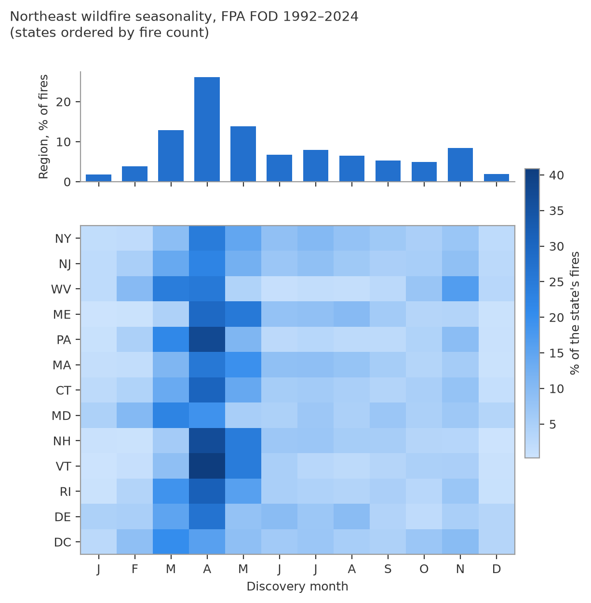
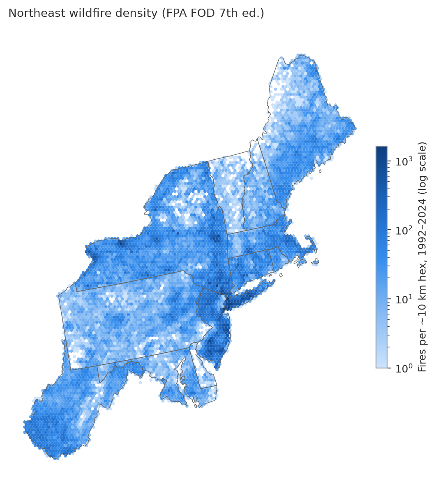
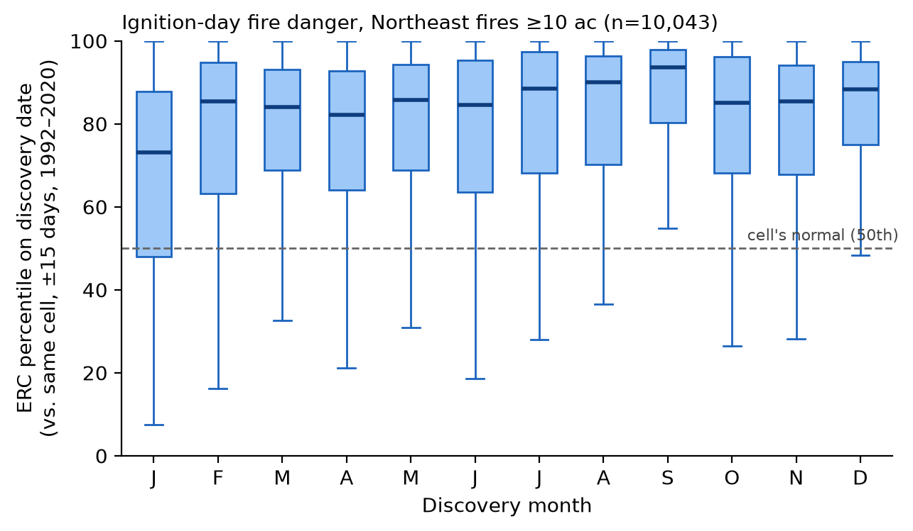
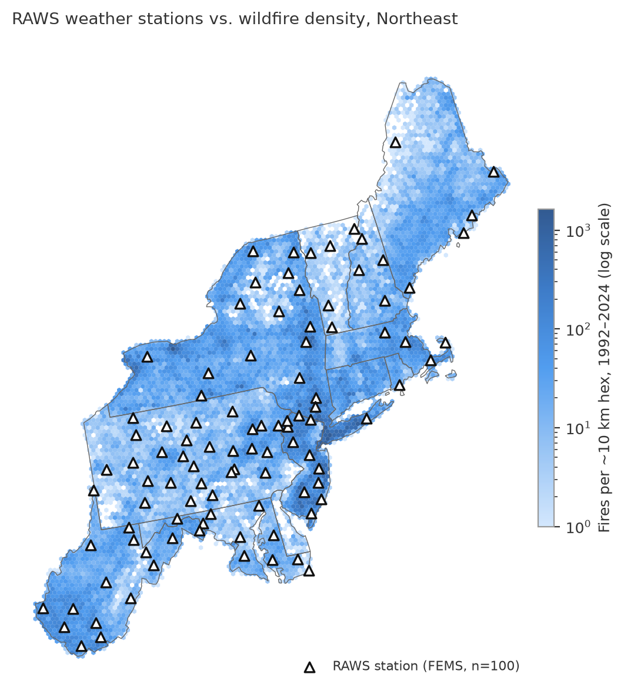

```{python}
from pathlib import Path
import pandas as pd
F = Path("../figures")
qa = pd.read_csv(F / "a_qa_counts.csv", index_col=0)["records"]
monthly = pd.read_csv(F / "a_monthly_count_by_state.csv", index_col=0).sum()
gap = pd.read_csv(F / "a_mtbs_gap.csv", index_col=0)["value"]
cause = pd.read_csv(F / "a_cause.csv")
annual = pd.read_csv(F / "a_annual_by_state.csv", index_col=0)
bys = pd.read_csv(F / "a_fires_by_state.csv", index_col=0)
b = pd.read_csv(F / "b_summary.csv").set_index(["group", "variable"])
bst = pd.read_csv(F / "b_median_percentile_by_state.csv", index_col=0)
bqa = pd.read_csv(F / "b_qa_counts.csv", index_col=0)["count"]
c = pd.read_csv(F / "c_binding_constraint_region.csv", index_col=0)
cf = pd.read_csv(F / "c_constraint_failures.csv")
cm = pd.read_csv(F / "c_hours_in_window_by_month.csv", index_col=0).sum()
dens = pd.read_csv(F / "d_station_density_by_state.csv", index_col=0)
land = pd.read_csv(F / "d_data_landscape.csv")

pct = lambda x, d=1: f"{x * 100:.{d}f}%"
n = lambda x: f"{int(x):,}"
spring_share = monthly.iloc[2:5].sum() / monthly.sum()
apr_share = monthly.iloc[3] / monthly.sum()
top = cause[cause["NWCG_GENERAL_CAUSE"] != "Missing data/not specified/undetermined"].iloc[:2]
unk = cause.loc[cause["NWCG_GENERAL_CAUSE"] == "Missing data/not specified/undetermined", "share"].sum()
nat = cause.loc[cause["NWCG_CAUSE_CLASSIFICATION"] == "Natural", "share"].sum()
erc, fm = b.loc[("all", "erc")], b.loc[("all", "fm100")]
sp_erc, sf_erc = b.loc[("spring", "erc")], b.loc[("summer_fall", "erc")]
wv_share = bst.loc["WV", "n_fires"] / bst["n_fires"].sum()
hot, temp_all, cold = cf["temp_too_hot_hours"].sum(), cf["temp_fail_hours"].sum(), cf["temp_too_cold_hours"].sum()
calm, strong = cf["wind_too_calm_hours"].sum(), cf["wind_too_strong_hours"].sum()
wet, dry = cf["rh_too_wet_hours"].sum(), cf["rh_too_dry_hours"].sum()
zero = " and ".join(dens.index[dens["raws_stations"] == 0])
nz = dens[dens["raws_stations"] > 0]
```

## Summary

- Northeast wildfires are a spring problem. `{python} pct(spring_share)` of the `{python} n(qa['clean_records'])` fires in the cleaned 1992–2024 record were discovered in March–May.
- Fires of 10 acres or more start on unusually dry days. The median fire started at the `{python} f"{erc['median_percentile']:.0f}"`th percentile of its own location's energy release component (ERC) for that time of year.
- Prescribed-burn windows are rare, and the limits are the same as in the Pacific Northwest: humidity and wind, not temperature. The window was open `{python} f"{c.loc['ALL_window_open','pct_complete_hours_failing']:.1f}"`% of hours at six RAWS stations in 2025.
- The main data gap is small fires. `{python} pct(gap['share_fires_lt500ac'])` of fires, carrying `{python} pct(gap['share_acres_lt500ac'])` of burned area, are below the size MTBS maps in the East.

## Q1. When and where do Northeast wildfires happen?

**`{python} pct(spring_share)` of fires were discovered in March–May, and April alone accounts for `{python} pct(apr_share)`.** Every state peaks in March or April, before leaf-out (@fig-season). A smaller second peak falls in November.

{#fig-season}

**Almost all fires are small.** `{python} pct(gap['share_fires_lt500ac'])` were under 500 acres. Those fires still burned `{python} pct(gap['share_acres_lt500ac'])` of the area.

**People start nearly all of them.** Only `{python} pct(nat)` had a natural cause. The most common known causes were `{python} top.iloc[0]['NWCG_GENERAL_CAUSE'].lower()` (`{python} pct(top.iloc[0]['share'])`) and `{python} top.iloc[1]['NWCG_GENERAL_CAUSE'].lower()` (`{python} pct(top.iloc[1]['share'])`). The cause was missing or undetermined for `{python} pct(unk)`.

**Reported fire density is highest in New Jersey's Pine Barrens, on Long Island, and in southern West Virginia** (@fig-density). Counts depend heavily on how each state reports (see Q4), so this map shows reported fires, not fire risk.

{#fig-density}

QA removed `{python} n(qa['dropped_likely_duplicate_same_day_1km_size'])` likely duplicate records: same day, same ~1 km location, same size. It also flagged `{python} n(qa['flagged_point_outside_reported_state'])` points that fall outside their reported state.

## Q2. What were fire-danger conditions at ignition?

**`{python} pct(erc['share_drier_than_median'])` of fires of 10 acres or more started on days with ERC above their location's median for that time of year.** The median fire sat at the `{python} f"{erc['median_percentile']:.1f}"`th percentile. 100-hour fuel moisture agrees: the median fire started at the `{python} f"{fm['median_percentile']:.1f}"`th percentile, so fuels were drier than usual. A one-sided sign test rejects "no difference from normal" for both (p < 0.001).

**Spring fires are not more extreme than summer or fall fires.** The median ERC percentile was `{python} f"{sp_erc['median_percentile']:.1f}"` in spring (n = `{python} n(sp_erc['n_fires'])`) and `{python} f"{sf_erc['median_percentile']:.1f}"` in summer/fall (n = `{python} n(sf_erc['n_fires'])`). Spring has more fires because more fuel is exposed and dry before leaf-out. In every season, fires still need an unusually dry day.

{#fig-erc}

**The result holds in every state.** State median ERC percentiles range from `{python} f"{bst['erc_pct'].min():.1f}"` to `{python} f"{bst['erc_pct'].max():.1f}"`. West Virginia supplies `{python} pct(wv_share, 0)` of these fires, so the regional numbers lean on it. The per-state table shows the pattern does not depend on WV.

Method: `{python} n(bqa['fires_ge_10ac'])` fires of 10 acres or more were matched to `{python} n(bqa['unique_grid_cells'])` gridMET cells; `{python} n(bqa['dropped_outside_grid'])` fell outside the grid. Each fire's discovery-day value was ranked against the same cell's values within ±15 days of that date across 1992–2020.

## Q3. What limits prescribed-burn windows in the Northeast?

**The burn window was open `{python} f"{c.loc['ALL_window_open','pct_complete_hours_failing']:.1f}"`% of hours across six RAWS stations in 2025.** Thresholds are Northeast timber-fuel medians from a survey of 31 burn plans (Fast, Ducey & Weyrick, UNH Cooperative Extension): RH 30–67 %, 20-ft wind 4.5–20 mph, temperature 35–87.5 °F, no measurable rain in the past 24 h.

**The binding constraints match the PNW: wind and humidity.** Wind failed `{python} f"{c.loc['wind','pct_complete_hours_failing']:.1f}"`% of hours and RH `{python} f"{c.loc['rh','pct_complete_hours_failing']:.1f}"`%. The direction matters. Wind failures were too calm (`{python} n(calm)` h), not too strong (`{python} n(strong)` h). RH failures were too humid (`{python} n(wet)` h), not too dry (`{python} n(dry)` h). Northeast windows close because the air is still and damp.

**The temperature ceiling almost never binds, as in the PNW.** Only `{python} n(hot)` of `{python} n(temp_all)` temperature-failure hours were too hot. The rest (`{python} n(cold)` h) were below the 35 °F floor, which the PNW prescription does not have.

**Window hours peak in March (`{python} n(cm['3'])` h) and April (`{python} n(cm['4'])` h)**, the same months fires peak. The conditions that allow a controlled burn overlap with the conditions under which wildfires start.

Code and station details: [fire-weather-windows](https://github.com/MegaDeadCowboy/fire-weather-windows), region `northeast`.

## Q4. Where are the data gaps?

```{python}
#| label: tbl-landscape
#| tbl-cap: "Main fire and weather datasets for the Northeast. Sources in the last column; Northeast numbers from this project's CSVs."
from IPython.display import Markdown
cols = {"dataset": "Dataset", "measures": "What it measures", "resolution": "Resolution",
        "coverage_latency": "Coverage / latency", "northeast_limitations": "Northeast limitations",
        "serves": "Who it serves", "source": "Source"}
Markdown(land.rename(columns=cols).to_markdown(index=False))
```

**Two states have no fire-weather station, and coverage is thin in northern New England.** FEMS lists `{python} n(dens['raws_stations'].sum())` active RAWS stations across the 12 states. `{python} zero` have none. Among states with stations, density runs from `{python} f"{nz['stations_per_10k_km2'].min():.2f}"` to `{python} f"{nz['stations_per_10k_km2'].max():.2f}"` per 10,000 km² of land (@fig-stations).

{#fig-stations}

**State reporting changes over time.** New York reported `{python} n(annual['NY'].min())` to `{python} n(annual['NY'].max())` fires per year. Delaware never reported more than `{python} n(annual['DE'].max())`. Swings this large follow reporting systems, not fire activity, so this project does not report fire-count trends.

### Data needs

1. **Small-fire perimeters.** `{python} pct(gap['share_acres_lt500ac'])` of Northeast burned area is in fires MTBS does not map. A small-fire burned-area product would cover more than half of the region's fire footprint.
2. **A consistent state reporting record.** New York's annual count ranges `{python} n(annual['NY'].min())`–`{python} n(annual['NY'].max())`, and Delaware's tops out at `{python} n(annual['DE'].max())`. Trend analysis needs a continuous, documented record from each state.
3. **More fire-weather stations.** `{python} zero` have no RAWS, and Maine has `{python} f"{dens.loc['ME','stations_per_10k_km2']:.2f}"` stations per 10,000 km². Pulling other mesonet stations into FEMS would help burn planning and NFDRS.
4. **Transport wind and smoke-dispersion data for burn planning.** Wind was the sole reason a window closed in `{python} f"{c.loc['wind','pct_complete_hours_sole_failure']:.1f}"`% of hours, almost always because it was too calm. Mixing height and transport wind would show whether those calm hours are truly unusable.
5. **Updated Northeast prescriptions.** The thresholds here come from a 2008 survey with few timber plans. ERC already separates fire days well (median `{python} f"{erc['median_percentile']:.0f}"`th percentile), so a current, shared prescription database would let these tools run on agreed numbers.

## Limitations

- **FPA FOD ends in 2024.** This project uses the 7th edition (1992–2024). Fires from 2025 onward are not included.
- **State reporting gaps.** Counts reflect each state's reporting system. Delaware's record is nearly empty and New York's changes by more than tenfold. Seasonality and size results are pooled across years and are less affected than counts.
- **gridMET cells vs. point fires.** Each fire is scored on a ~4 km cell. A fire point is not a cell average. Discovery date can lag ignition. gridMET ERC uses one fuel model (G) everywhere.
- **Few Northeast RAWS.** Part C uses six stations and one year (2025). Results describe those sites, not every forest type. FEMS QC flags were blank for recent hours, so some unflagged errors may remain.
- **Thresholds source.** The Northeast prescription is a set of medians from a 2008 survey, with 8–17 timber plans per parameter. Real burn plans vary by site and objective.
- **Part B leans on West Virginia**, which supplies most fires of 10 acres or more. Per-state medians are reported to check this.
- **Station density uses land area, not forest area**, and DC is excluded because it was not in the station query.

## Sources

- Short, K.C. 2026. Spatial wildfire occurrence data for the United States, 1992–2024 [FPA_FOD_20260615]. 7th ed. USFS Research Data Archive. doi:10.2737/RDS-2013-0009.7
- Abatzoglou, J.T. 2013. Development of gridded surface meteorological data for ecological applications and modelling. Int. J. Climatol. 33:121–131.
- Fast, A.J., Ducey, M.J., Weyrick, R.R. Common Prescribed Burning Prescription Parameters in Northeastern Fuels. UNH Cooperative Extension.
- USFS Fire Environment Mapping System (FEMS), Climatology API External User Guide (2025).
- MTBS (mtbs.gov); USGS EROS. NASA FIRMS (firms.modaps.eosdis.nasa.gov).
- Every method choice: `docs/decision_log.md`.
